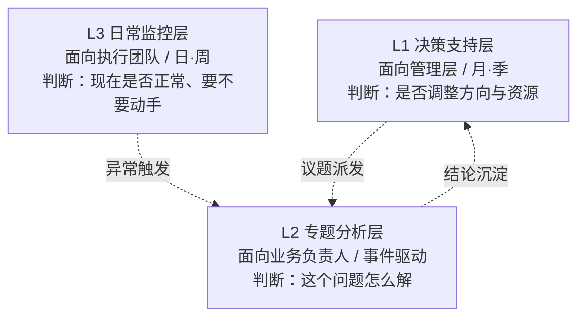

# 数据分析报告体系设计说明 v1.0

> **定位**：解决"报告不够深入、难以支撑业务决策"的系统性设计。
> **原则**：每份报告必须回答一个决策问题；无决策问题的报告不立项。
> **范围**：报告分类、受众、结构模板、深度保障机制、落地步骤。
> **不含**：具体业务数据、技术实现细节。

---

## 第 0 部分 · 核心判断

"报告不够深入"的根因，通常不是分析师不会分析，而是**报告目标被设成了"把数据说清楚"，而不是"把决策说清楚"**。前者产出描述，后者产出判断。

因此本体系的全部结构围绕一条主线：**一份报告 = 一个决策问题的完整闭环**。

---

## 第 1 部分 · "不够深入"的典型表现与改进方向

### 1.1 六类病症与可判定改进判据

| # | 典型表现 | 病根 | 改进方向（可判定判据） |
|---|---|---|---|
| 1 | 只描述现象：报"本月转化率下降 3.2%" | 缺"所以呢"这一跳 | 每条核心指标变化后必须紧跟一句"这意味着/这指向"，且该句可被证伪 |
| 2 | 无对比基准：孤立数字，无同比/环比/目标/同类 | 数字无参照系 = 不可解读 | 每个读数必须带三类参照之一：时间基准、目标基准、同类基准 |
| 3 | 无拆分：只报总量，不看结构 | 总量掩盖结构（辛普森悖论高发） | 总量指标必须至少下钻一层，并说明结构效应 vs 组内效应 |
| 4 | 归因靠故事：用"大促/季节/竞品"解释但无量化 | 时间先后被当因果 | 归因必须可加和拆解（贡献度量化），并标注"已验证/待验证/仅背景" |
| 5 | 结论不打标：结论与假设混排 | 置信度不透明 | 每条结论挂置信标（高/中/低）+ 验证方式 |
| 6 | 无行动项：结尾是"建议持续关注" | 终点不是决策，是交作业 | 每份报告必须产出一条"谁/何时/做什么/预期影响"的可执行项 |

### 1.2 贯穿全体系的单一判据（评审门槛）

> **合格判据**：删掉一份报告的所有图表和数字后，仅凭文字仍能读出
> 「发生了什么 → 为什么 → 该做什么」。
>
> 读不出 = 不合格。此判据不依赖图表美观度，可机械执行。

### 1.3 典型病症的改写示例（形式说明，非真实数据）

| 不合格写法 | 合格写法（结构示意） |
|---|---|
| 本月指标 X 下降 3.2% | 本月指标 X 环比下降 3.2%（对比：目标为持平，同期均值 ±0.8%）→ 主要来自 A 分群贡献 2.1pt 降幅，其余分群基本持平 → 指向 A 分群环节问题，需专题 |
| 建议持续关注该指标 | 建议由 [责任方] 在 [时点] 前对 A 分群环节执行 [动作]，预期回收 [幅度]，验证指标为 [指标] |
| 下降可能与竞品活动有关 | 竞品活动为背景信息（时间相关，未验证）；已验证的贡献因子为 A 分群环节，贡献度 2.1pt |

---

## 第 2 部分 · 报告体系整体框架

### 2.1 分层逻辑

三层**不按重要程度**分，而按**决策时距**分：

- 决策周期越长 → 越往"判断与取舍"走（L1）
- 决策周期越短 → 越往"状态与触发"走（L3）

### 2.2 架构图



### 2.3 三层对照表

| 层级 | 报告类型 | 目标受众 | 更新频率 | 核心内容 | 决策落点 |
|---|---|---|---|---|---|
| L1 | 决策支持报告 | 管理层 / 决策委员会 | 月报、季报、关键节点专项 | 战略指标走势、目标达成与偏差、重大偏离归因结论、资源投向建议与取舍 | 是否调方向、调资源、调目标 |
| L2 | 专题分析报告 | 业务负责人 / 相关职能 | 事件驱动（异常 / 机会 / 上线复盘） | 一个明确问题闭环：现象界定 → 根因拆解 → 验证 → 方案与影响测算 | 具体动作怎么定、优先级排序 |
| L3 | 日常监控报告 | 执行团队 / 一线运营 | 日报、周报 | 指标状态、警戒线触发、波动初步定位、待办流转 | 是否立即处置、升级给谁 |

### 2.4 三条联动关系（体系"活"起来的关键）

1. **监控触发专题**：L3 命中警戒线或连续异常 → 自动升级为 L2 专题。不允许在日报里"提一嘴"就过去。
2. **专题沉淀决策**：L2 得出跨期有效的结论性判断 → 提炼进 L1，作为方向调整依据。
3. **决策派发议题**：L1 提出的待验证方向 → 转成 L2 的专题命题。

> 缺了这三条，三层会退化成三套各自为政的模板。

### 2.5 深度配比原则

| 层级 | 重心 | 硬约束 |
|---|---|---|
| L3 | 发现 | 不允许下结论性判断 |
| L2 | 归因 | 不允许只有相关性而无验证 |
| L1 | 判断 | 不允许以"待进一步分析"作为结论 |

---

## 第 3 部分 · 标准结构模板

三个模板共享骨架：**背景目标 → 口径 → 指标与拆分 → 方法 → 发现 → 行动**。
区别在"方法"与"行动"的深度。

### 模板 A｜L1 决策支持报告

```
1. 决策摘要（Answer-First，≤ 1 页）
   - 本期最重要的一个判断（结论先行，带量化）
   - 支撑证据 2–3 条
   - 置信度与不确定性说明
   - 建议动作与预期影响
2. 分析背景与目标
   - 本期要回答的决策问题（1 个主问题）
   - 时间范围 / 对比基准 / 决策时点
3. 数据口径说明
   - 指标定义、统计口径、纳入排除规则、数据截止时间、已知口径变更
4. 核心指标与目标对照
   - 主指标：实际 vs 目标 vs 上期，达成状态（超前 / 达标 / 风险）
   - 驱动指标拆解（影响主指标的关键因子及各自贡献）
5. 分析方法
   - 对比：同比 / 环比 / 对目标 / 对同类
   - 归因拆解：贡献度分解（结构性 vs 组内性）
   - 趋势与节奏：是否按计划节奏推进
6. 关键发现
   - 每条发现 = 现象 + 量化 + 已/待验证标注
   - 明确"哪些偏离需关注、哪些属正常波动"
7. 业务行动建议
   - 建议项 + 依据 + 预期影响 + 负责方向 + 验证节点
   - 明确取舍：建议做什么，同时建议不做什么
8. 待决问题与后续专题
```

### 模板 B｜L2 专题分析报告

```
1. 问题界定（What & So What）
   - 现象描述 + 量化（幅度、时点、影响面）
   - 为什么值得解（与主指标的关联）
2. 分析目标与假设
   - 把大问题拆成 2–4 个可验证子问题
   - 预置假设清单（待证实 / 证伪）
3. 数据口径与范围
   - 分析对象、颗粒度、时间窗、样本/总体、关键口径说明
4. 分析路径（方法与拆分维度）
   - 拆分维度：时间 / 分群 / 渠道 / 流程环节 / 地域等
   - 方法选择：对比、下钻、归因分解、相关性/回归、（必要时）实验
   - 每条结论对应的验证方式
5. 关键发现
   - 逐层下钻过程与中间结论
   - 根因候选排序（按贡献度），明确哪些被排除及排除依据
   - 比率型指标需分离分子效应 / 分母效应
6. 结论与置信度
   - 已验证结论 / 强假设 / 未解释部分，分别标注
7. 业务行动建议
   - 方案选项（含"不做"选项）+ 各自预期影响与成本
   - 优先级建议 + 落地路径 + 验证指标（怎么知道做对了）
8. 局限与后续
```

### 模板 C｜L3 日常监控报告

```
1. 一句话状态
   - 整体是否正常 + 有无触发警戒
2. 核心指标快照
   - 指标 | 当期值 | 对比基准 | 状态灯 | 简要解读
   - 状态灯只在能驱动动作时使用
3. 异常清单
   - 异常项 | 触发规则 | 初步定位（哪个拆分维度在动）| 建议处置 / 升级对象
4. 波动初判
   - 分类：正常波动 / 需观察 / 需立即升级
5. 待办流转
   - 今日新增待处置项 + 昨日项状态闭环
```

---

## 第 4 部分 · 保障分析深度的机制

模板解决"长什么样"，机制解决"凭什么深得下去"。

### 机制 1｜指标拆解路径

统一按乘法/加法链拆解，**拆到能被某个团队直接影响的变量为止**。

- **比率型指标**：`结果 = 分子 ÷ 分母` → 分离分子效应、分母效应 → 再按维度下钻
- **总量型指标**：`总量 = 量 × 转化率 × 单价` 类链式拆解 → 定位哪一段在动
- **终点判据**：拆到的变量必须对应一个**责任主体**；否则继续拆或改拆法

### 机制 2｜异常归因流程（标准化，防"讲故事"）

```
触发 → 复现 → 定界 → 拆解 → 验证 → 定性 → 沉淀
```

| 步骤 | 动作 | 要点 |
|---|---|---|
| 1 触发 | 警戒线命中 / 连续异常 | 触发规则在 L3 明确定义 |
| 2 复现 | 确认异常真实存在 | 先排除口径变更、数据延迟、重复统计 |
| 3 定界 | 确定全局还是局部 | 判断哪个切片（时间/分群/渠道）在动 |
| 4 拆解 | 用机制 1 量化各候选因子贡献度 | 贡献度必须可加和 |
| 5 验证 | 对最大贡献因子做独立验证 | 换口径、换数据源、负对照 |
| 6 定性 | 结论标注等级 | 已验证 / 强假设 / 仅背景 |
| 7 沉淀 | 结论进 L2/L1，触发规则进 L3 | 形成闭环 |

### 机制 3｜结论验证与迭代

- **置信标**：高（多源交叉验证）/ 中（单源但逻辑自洽）/ 低（仅相关性）
- **方向性断言必须可证伪**：写"不许变"用相等判据，写"不许少"用不小于判据，避免方向写错使报告"看起来总是对的"
- **结论回访**：L1/L2 结论设回访点，到期核对判断是否成立；未成立则复盘是数据问题还是推断问题
- **版本可追溯**：同一议题多期报告保留链路，可看到判断如何演化

### 机制 4｜报告质量评审门槛（发布前自检）

| # | 自检项 | 通过标准 |
|---|---|---|
| 1 | 去图表测试 | 仅凭文字能读出"发生了什么→为什么→怎么办" |
| 2 | 参照系 | 每条核心数字带基准 |
| 3 | 结论可信度 | 每条结论有置信标与验证方式 |
| 4 | 证伪性 | 明确写出"什么不成立/被排除" |
| 5 | 行动项 | 有"谁/何时/做什么/预期影响" |
| 6 | 问题对齐 | 回答了承诺回答的决策问题，而非邻近的更容易的问题 |

---

## 第 5 部分 · 落地步骤

| 阶段 | 动作 | 产出 | 验收方式 |
|---|---|---|---|
| 第 1 步：定标准 | 确立三层报告清单、受众、频率、指标口径字典 | 报告体系清单 + 指标口径字典 | 每个指标有唯一定义与责任主体 |
| 第 2 步：接机制 | 上线异常归因流程、结论回访点、拆解路径规范 | 归因流程图 + 拆解路径库 + 回访台账 | 归因流程走通一个完整闭环 |
| 第 3 步：套模板 | 用三个模板改造现有报告，先选 1 份 L1、2 份 L2、1 份 L3 做样板 | 4 份样板报告 | 通过机制 4 的六条门槛 |
| 第 4 步：跑循环 | L3 触发 → L2 专题 → L1 决策 三层联动常态化 | 季度体系复盘 | 三层联动真实发生，而非并列存在 |

> **推进顺序建议**：先做第 2 步（归因流程）再做第 3 步（模板套用），效果更实——
> "不深入"的痛点在归因环节，模板只是壳。

---

## 第 6 部分 · 待确认事项

1. 三层各自的**具体指标清单**需结合业务实际填充（本设计只定结构，不定具体指标）。
2. **警戒线阈值**需在 L3 上线时按指标波动特性逐个标定。
3. **责任主体映射**需要在第 1 步与各业务方对齐后固化。
