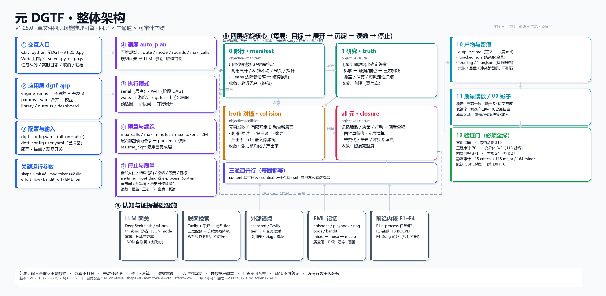

# 元DGTF 整体架构图（v1.25.0）



- 矢量版：`元DGTF-整体架构-v1.25.0.svg`
- Mermaid 源：`元DGTF-整体架构-v1.25.0.mmd`
- 生成脚本：`_mk_arch_diagram.py`
- **V2 三平面设计图**：`../元DGTF-V2-三平面架构.md`（Mermaid 源：`元DGTF-V2-三平面架构.mmd`）

## 怎么读

1. **左列（①–③）**：人怎么进来 —— CLI / Web 工作台 → 应用层（任务、参数、产物索引）→ 配置与输入。
2. **中左（④–⑦）**：这次怎么跑 —— auto_plan 五维规划 → serial/A–H 阶段 DAG → 预算与续跑 → 停止与质量读数。
3. **中右（⑧）**：核心四层螺旋 —— 0 修行 → 1 研究 → both 对撞 → all 元；下方是三通道 content/context/self。
4. **底部（⑨）**：认知与证据基础设施 —— LLM 网关、联网检索、外部锚点、EML 记忆、前沿内核 F1–F4。
5. **右列（10–12）**：跑完留下什么 —— md/packed/run 归档 → 质量读数 → 验证门。
6. **虚线**表示回流/经验（carry、自省、EML 建议）；实线是主流程。

## 四层一眼表

| 层 | 目标 | 主要动作 | 收敛/停止 |
|---|---|---|---|
| 0 修行 | manifest | 阴阳展开、& 撞不动、线头、探针 | Heaps 边际新增率 → 结构饱和（趋近无穷） |
| 1 研究 | truth | 拆解 → 证据/锚点 → 三态判决 | 覆盖率 / 清算 / 可判定性冻结（有限） |
| both 对撞 | collision | 阴/阳两臂 → 第三者 → 张力 | 产出率 ×(1−语义停滞罚) |
| all 元 | closure | 结晶 / 决策 / 行动 + 回看全程 | 四件事留痕完整度 |

三通道每圈都写：**content**（写了什么）、**context**（凭什么写）、**self**（自己怎么看这次写）。

## 关键路径

- 引擎：`元DGTF-V1.25.0.py`（单文件 / 纯 CRLF / 28327 行）
- 配置：`dgtf_config.yaml`（all_on=false，最优值逐项显式）；`dgtf_config.user.yaml` 已清空
- 前端：`dgtf_app/`（server / engine_runner / params / static）
- 产物：`outputs/`（md + packed.json + run.log/run.json）
- 证据：`audits/`、`v12365_报告.md`、`_审计_v12364_全维度.md`

## 重新生成

```bash
python _mk_arch_diagram.py
```

> 需要 Pillow（`pip install pillow`）。若系统 Python 没有，可用本机 bundled Python：
> `C:\Users\18432\.dsh\dsh-runtimes\dsh-primary-runtime\dependencies\python\python.exe _mk_arch_diagram.py`。
> 脚本同时输出 PNG / SVG / Mermaid；改布局只需改脚本顶部的 `BOXES` 与箭头坐标。

## Mermaid 源

```mermaid
flowchart TB
  subgraph UI[交互 / 应用]
    CLI[CLI 元DGTF-V1.25.0.py]
    WEB[Web 工作台 server.py + app.js]
    RUN[engine_runner 任务/日志/归档]
    CFG[配置 factory + user yaml]
  end
  subgraph ORCH[调度 / 预算 / 停止]
    PLAN[auto_plan 五维规划]
    MODE[serial / A-H 阶段 DAG]
    BUDGET[max_calls / max_minutes / max_tokens]
    STOP[停止与质量读数]
  end
  subgraph CORE[四层螺旋]
    L0[0 修行 manifest]
    L1[1 研究 truth]
    BOTH[both 对撞 collision]
    ALL[all 元 closure]
    CH[三通道 content / context / self]
  end
  subgraph INFRA[认知与证据基础设施]
    LLM[LLM 网关]
    WEB2[联网检索]
    ANC[外部锚点]
    EML[EML 记忆]
    F[前沿内核 F1-F4]
  end
  subgraph OUT[产物 / 验证]
    MD[md + packed.json + run 归档]
    Q[质量读数]
    GATE[冒烟/验收/审计/变异体/前端自检]
  end
  CLI --> RUN
  WEB --> RUN
  CFG --> PLAN
  RUN --> PLAN
  PLAN --> MODE --> BUDGET --> STOP
  STOP --> CORE
  CORE --> MD --> Q --> GATE
  L0 --> L1
  L0 --> BOTH
  L1 --> BOTH
  BOTH --> ALL
  ALL -. carry / 自省 .-> L0
  CORE <--> INFRA
  EML -. 调度/守卫建议 .-> STOP
```



> 图是 v1.25.0 的静态快照；主文件升版后请同步改标题与验证门数字再重跑脚本。
